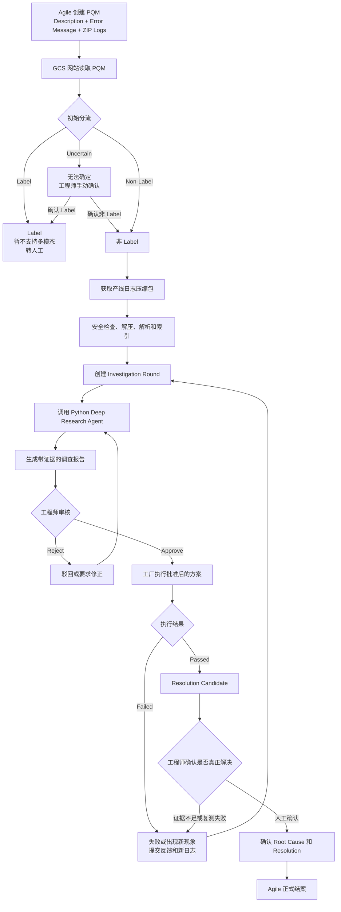

# PQM Agent 运转机制与定位理解

## 1. 文档目的

本文档用于说明目前对 PQM Intelligent Investigation Agent 的理解，包括：

- PQM Agent 的业务定位；
- PQM Agent 从接收问题到结案的完整运行方式；
- React、Node.js、Python Agent、SQL Server 和 Agile 的职责边界；
- Deep Research Agent 在每一轮调查中的工作方式；
- 工厂验证失败后如何进入下一轮调查；
- Agent 与工程师之间的关系；
- 为什么 Agent 应作为辅助工具，而不是自动决策者。

需要先明确当前状态：

> 现在代码中已经存在的是通用 Deep Research Agent；PQM Agent 是基于该 Agent 设计的业务集成方案，目前尚未实际实现。

---

## 2. PQM Agent 的核心定义

PQM Agent 不是一个简单聊天机器人，也不是一个自动填写 Root Cause 的工具。

它是一个基于 Agile PQM 数据和产线日志的递进式调查系统：

```text
读取问题 → 分析日志 → 提出假设 → 给出验证方案
→ 工程师审核 → 工厂执行 → 获取反馈和新日志
→ 修正或排除假设 → 继续验证
→ 人工确认 Root Cause → Agile 结案
```

最核心的定义是：

> PQM Agent 根据 Agile 中的 Issue Description、Error Message 和产线日志进行证据检索，通过 Deep Research 多 Agent 完成每一轮故障分析，再由工程师和工厂进行真实验证，并根据反馈不断排除假设，直到人工确认解决方案和 Root Cause。

---

## 3. Agent 的业务定位

现阶段 Agent 的定位是：

> **工程师调查助手（Decision Support Agent），而不是自动决策或自动结案系统。**

Agent 可以自动化大量重复、耗时的信息处理工作，但是最终决策权仍然属于工程师。

### 3.1 Agent 可以自动完成的工作

- 读取 PQM Title、Description 和 Error Message；
- 对问题进行 Label、非 Label 或无法判断的初始分流；
- 安全处理和解析产线日志；
- 检索错误码、失败步骤和关键时间线；
- 引用具体文件和行号作为证据；
- 生成当前故障假设；
- 为每个假设整理支持证据和反对证据；
- 对比不同调查轮次的新旧日志；
- 记录已尝试方案和已排除原因；
- 提出下一步验证方案；
- 定义工厂执行后的成功标准；
- 生成调查报告草稿。

### 3.2 必须由工程师完成的工作

- 确认无法明确判断的 Label/非 Label 分类；
- 审核 Agent 的分析结果；
- 判断 Agent 建议是否安全、合理和可执行；
- 决定是否将建议提供给工厂；
- 评估工厂的执行结果；
- 区分临时规避方案和真正修复；
- 确认最终 Root Cause；
- 决定是否结束调查；
- 在 Agile 中正式结案。

整体职责关系为：

```text
Agent：找证据、提假设、给建议、整理历史
工程师：做判断、控风险、负责任、确认结论
工厂：执行验证并反馈结果
```

因此，更准确的说法是：

> **Agent 自动化调查过程，但不取代工程师的最终决策权。**

---

## 4. 为什么必须保留人工决策

PQM 可能涉及：

- BIOS；
- Hardware；
- Image；
- Network；
- Infrastructure；
- 生产线配置；
- 测试流程；
- 工厂操作。

如果错误建议被直接执行，可能影响：

- 产线生产；
- 测试结果；
- 系统配置；
- 产品质量；
- 调查方向；
- PQM 正式记录。

所以必须保留 Human-in-the-loop：

```text
Agent 生成建议
      ↓
工程师审核
      ↓
工厂执行
      ↓
工程师判断执行结果
      ↓
人工确认 Root Cause 和结案
```

这并不是 Agent 能力不足，而是生产系统中合理的风险控制设计。

---

## 5. PQM Agent 的三个循环

整个系统由三个不同层次的循环组成。

### 5.1 第一层：Deep Research 内部推理循环

```text
Supervisor
   ↓
Researcher 搜索日志
   ↓
Think Tool 反思
   ↓
继续搜索或完成
   ↓
Evaluator 评分
   ↓
Red Team 挑错
   ↓
Supervisor 修正
```

这一层解决的问题是：

> 当前这一轮调查如何尽可能全面、准确地分析已有证据。

### 5.2 第二层：Investigation Round 调查循环

```text
Agent 分析本轮数据
      ↓
工程师审核本轮建议
      ↓
工厂执行验证
      ↓
返回成功、失败或新现象
      ↓
需要时创建下一轮
```

这一层解决的问题是：

> Agent 提出的方案能否通过真实生产流程验证。

### 5.3 第三层：PQM Case 生命周期

```text
PQM 创建
   ↓
初始分流
   ↓
多轮调查
   ↓
确认 Validated Resolution
   ↓
确认 Root Cause
   ↓
Agile 正式结案
```

这一层解决的问题是：

> 整个 PQM 如何从创建一直走到正式关闭。

---

## 6. 整体运行流程



---

## 7. 第一步：从 Agile 获取 PQM

工厂把以下内容提交到 Agile：

- PQM Title；
- Description；
- Error Message；
- 工厂信息；
- 产品和平台信息；
- 测试阶段；
- 产线日志压缩包。

例如：

```text
FAILED: D08 SATA Operation
LNL BLUERIDGE not support RAIDON
```

此时 `Root Cause` 为空。

Root Cause 是调查结果，不能作为初始分类输入。

PQM Agent 的初始输入应该是：

```text
Title
Description
Error Message
Factory
Product / Platform
Failed Phase
Attachment Manifest
```

---

## 8. 第二步：初始分流

在真正运行 Deep Research 之前，系统先做一次轻量级分流。

### 8.1 Label 类型

例如：

```text
CCC2 DY085 标签打印不良
```

判断结果：

```text
Triage Result: LABEL
```

因为当前不做多模态图片分析，所以系统应：

- 不调用 Deep Research；
- 不生成自动解决建议；
- 显示“当前暂不支持 Label 图片问题”；
- 转给工程师人工处理。

### 8.2 非 Label 类型

例如：

```text
FAILED: D08 SATA Operation
LNL BLUERIDGE not support RAIDON
```

判断结果：

```text
Triage Result: NON_LABEL
```

然后进入日志调查流程。

### 8.3 无法确定

如果描述中没有足够信息：

```text
Triage Result: UNCERTAIN
```

系统要求工程师手动确认，不能让模型强制选择。

---

## 9. 第三步：安全处理日志

非 Label 问题确认后，系统通过 Agile Attachment Connector 获取日志压缩包。

不能直接把整个 ZIP 文件交给大模型，而是先执行：

```text
Agile ZIP
   ↓
检查文件大小和类型
   ↓
检查 Zip Slip 和 Zip Bomb
   ↓
解压到隔离临时目录
   ↓
识别允许处理的日志文件
   ↓
按时间、事件和上下文切分
   ↓
建立可检索的证据索引
```

每段日志证据需要保留：

```text
Evidence ID
原始文件名
行号范围
时间戳
日志原文
文件哈希
```

例如：

```text
Evidence ID: E-001
File: D08/test.log
Lines: 1250-1278
Timestamp: 2026-09-08 10:21:35

FAILED: SATA Operation
Expected mode: RAIDON
Actual mode: AHCI
```

这样 Agent 的结论就可以被追溯：

```text
结论 → Evidence ID → 文件名 → 行号 → 原始日志哈希
```

---

## 10. 第四步：创建调查 Case 和 Round

Node.js 后端创建：

```text
PQM Investigation Case
└── Round 1
```

Round 1 包含：

- 当前 PQM 数据快照；
- Description；
- Error Message；
- 本轮日志列表；
- 当前已执行过的方案；
- 已排除的假设；
- 最新工厂反馈；
- 当前调查状态。

第一次调查时通常是：

```text
Previous Actions: None
Excluded Hypotheses: None
Factory Feedback: None
```

Node 随后创建异步 Agent Job：

```text
Job Status: QUEUED
```

前端可以查询以下状态：

```text
QUEUED
PREPARING_LOGS
INDEXING
ANALYZING
VALIDATING
REVIEW_REQUIRED
FAILED
CANCELLED
```

---

## 11. 第五步：调用 Python Deep Research Agent

Python Agent Service 从 Job 中读取：

```text
caseId
roundId
psrNumber
artifactIds
previousRounds
factoryFeedback
```

然后把本轮信息整理成 Deep Research Agent 能理解的调查请求，例如：

```text
调查当前 PQM 的失败原因。

PQM Description:
FAILED: D08 SATA Operation
LNL BLUERIDGE not support RAIDON

当前为 Round 1。
尚未执行过解决方案。

必须：
1. 只根据提供的日志证据分析；
2. 不得直接确认 Root Cause；
3. 给出可执行的验证步骤；
4. 为每个结论引用 Evidence ID；
5. 定义工厂验证成功的标准。
```

然后调用现有 Deep Research 主图：

```text
write_research_brief
        ↓
write_draft_report
        ↓
supervisor_subgraph
        ↓
final_report_generation
```

Deep Research Agent 的图结构保持不变。

---

## 12. Deep Research 内部如何调查

### 12.1 Write Research Brief

Agent 先把 PQM 转换成调查计划，例如：

```text
1. 确认 SATA Operation 失败的直接日志证据；
2. 对比 Expected RAID Mode 和 Actual Mode；
3. 检查 BIOS 配置；
4. 检查平台是否支持 RAIDON；
5. 排除测试脚本或 Image 配置问题；
6. 提出最小风险的验证步骤。
```

### 12.2 Write Draft Report

在证据还不充分时，先生成报告骨架：

```text
问题摘要
已知事实
待调查方向
假设
证据
建议
缺失信息
```

此时 Draft 不是最终结论。

### 12.3 Supervisor 拆解任务

Supervisor 可能把问题拆分给多个 Researcher：

```text
Researcher 1：调查失败时间线和关键错误。
Researcher 2：调查 BIOS、SATA 和 RAID 配置。
Researcher 3：调查平台兼容性、测试脚本和其他原因。
```

### 12.4 Researcher 搜索 PQM 证据

原始 Deep Research Agent 使用：

```text
tavily_search
think_tool
```

PQM 版本将网络搜索替换为：

```text
pqm_evidence_search
think_tool
```

Agent 的节点和循环不变，只是搜索的数据源从互联网变成 PQM 数据和生产日志。

Researcher 可能搜索：

```text
SATA Operation FAILED
RAIDON
AHCI
BIOS SATA mode
D08 failure before and after
```

工具返回相关日志证据，而不是网页内容。

### 12.5 Think Tool 反思

每次检索后，Researcher 评估：

```text
现在确认了什么？
当前证据支持哪个假设？
有什么证据与假设矛盾？
还缺少什么日志？
是否需要继续搜索？
```

产品只展示证据和决策摘要，不展示模型的隐藏 Chain of Thought。

### 12.6 压缩 Researcher 结果

每个 Researcher 最后输出局部调查结果：

```text
发现：
- D08 在 SATA Operation 阶段失败；
- 日志期望 RAIDON；
- 当前检测值可能不是 RAIDON；
- 尚未确认是 BIOS 配置、平台不支持还是测试脚本错误。

相关证据：
- E-001
- E-006
- E-009
```

### 12.7 Supervisor 汇总

Supervisor：

- 合并相同发现；
- 识别不同 Researcher 之间的冲突；
- 判断是否还有信息缺口；
- 决定继续调查还是精修报告。

### 12.8 Evaluator 评分

Evaluator 检查：

- 调查是否全面；
- 结论是否准确；
- 前后是否一致；
- 是否回答了原始 PQM 问题。

### 12.9 Red Team 挑错

Red Team 主动质疑：

```text
为什么认为是 BIOS 配置？
日志是否真的证明了 RAID 模式不一致？
有没有可能是平台根本不支持 RAIDON？
当前建议是否会产生其他风险？
成功标准是否足够明确？
```

如果发现问题，就把批评意见交回 Supervisor 修正。

### 12.10 Final Report

最终输出的是当前轮次调查报告，而不是直接关闭 PQM。

---

## 13. 第一轮调查结果示例

假设 Round 1 最终输出：

```text
Observed Facts
- D08 在 SATA Operation 阶段失败。
- 日志包含“not support RAIDON”。
- 当前没有足够证据确认具体 Root Cause。

Current Hypotheses
H1. BIOS SATA Operation 配置与流程要求不一致。
H2. 当前平台或 BIOS 版本不支持 RAIDON。
H3. 测试流程使用了不适用于该平台的 RAIDON 检查。

Recommended Action
1. 确认当前 BIOS SATA Operation 实际值。
2. 对比该机型标准 BIOS 配置。
3. 确认当前 BIOS 版本的 RAID 支持矩阵。
4. 使用批准的配置重新执行 D08。

Success Criteria
- D08 SATA Operation 步骤通过。
- 日志不再出现“not support RAIDON”。
- 后续测试步骤无新增失败。

Root Cause Status
SUSPECTED

Confidence
Medium
```

此时不能写：

```text
Confirmed Root Cause
```

因为工厂还没有完成验证。

---

## 14. 第六步：工程师审核

Agent 报告不会直接发送给工厂。

工程师可以执行：

```text
Approve
Reject
Request Revision
```

如果工程师认为建议正确：

```text
Round 1 → WAITING_FACTORY
```

然后由工程师把批准后的步骤提供给工厂。

这样可以避免模型提出有风险的 BIOS、硬件或产线操作后被自动执行。

---

## 15. 第七步：工厂验证

工厂执行方案后可能出现两种结果。

### 15.1 工厂验证通过

工厂反馈：

```text
修改配置后 D08 通过。
```

系统不会立即自动确认 Root Cause，而是进入：

```text
RESOLUTION_CANDIDATE
```

工程师需要判断：

- 是否可重复通过；
- 是否确实是该配置导致；
- 是否只是偶发重试成功；
- 是永久修复还是 workaround；
- 是否需要额外验证。

确认后才进入：

```text
CONFIRMED ROOT CAUSE
RESOLVED
```

最后由工程师在 Agile 中正式结案。

### 15.2 工厂验证失败

工厂可能反馈：

```text
已确认 SATA Operation 为 RAIDON，
但 D08 仍然出现相同错误。
```

并上传新的生产日志。

系统随后创建：

```text
Round 2
```

---

## 16. 第二轮如何递进调查

Round 2 的输入不仅包含新日志，还包含历史调查账本：

```text
Previous Action
- 已确认 SATA Operation 设置为 RAIDON。

Factory Result
- 设置正确，但问题仍然存在。

Excluded Hypothesis
- 单纯 BIOS SATA Mode 配置错误的可能性降低。

New Evidence
- Round 2 新日志。
```

Agent 会根据历史调整调查方向：

```text
Round 1：
优先验证 BIOS 配置。

Round 2：
BIOS 配置已验证但仍失败，
转向检查 BIOS 版本支持、平台兼容性和测试脚本。
```

这就是递进式调查。

Agent 每一轮都必须知道：

- 哪些动作已经执行；
- 工厂执行结果；
- 哪些假设已被排除；
- 哪些假设仍然成立；
- 新日志相比旧日志发生了什么变化。

因此不会每一轮都从零开始，也不应重复提出已经验证失败的方案。

---

## 17. 多轮状态如何保存

Deep Research Agent 只负责一轮推理，Node.js 和 SQL Server 负责整个 PQM 生命周期。

```text
Case
├── Round 1
│   ├── Evidence
│   ├── Hypotheses
│   ├── Recommended Action
│   ├── Human Approval
│   └── Factory Result = Failed
│
├── Round 2
│   ├── New Evidence
│   ├── Excluded Hypotheses
│   ├── New Recommended Action
│   └── Factory Result = Failed
│
└── Round 3
    ├── Validated Resolution
    ├── Confirmed Root Cause
    └── Closed
```

Python Agent 可以保持相对无状态：

```text
每次调用：
读取本轮上下文
完成本轮调查
返回本轮报告
结束
```

网站数据库负责长期保存整个调查过程。

---

## 18. React、Node.js 和 Python 的职责

### 18.1 React

负责：

- 展示 PQM 信息；
- 启动调查；
- 展示 Agent 任务状态；
- 展示日志证据和调查报告；
- 提交人工审核结果；
- 提交工厂反馈；
- 展示调查时间线。

### 18.2 Node.js

负责：

- SSO 身份认证；
- 用户和 PQM 权限检查；
- 读取 Agile 同步数据；
- 创建 Case 和 Round；
- 管理 Agent Job；
- 保存 Agent 结果；
- 管理审核和状态机；
- 向 React 返回统一结果。

### 18.3 Python Agent Service

负责：

- 处理和索引日志；
- 构建本轮 Agent 上下文；
- 提供 PQM Evidence Search Tool；
- 调用 Deep Research Agent；
- 验证输出结构和证据引用；
- 返回结构化调查结果。

### 18.4 SQL Server

负责保存：

- Investigation Case；
- Investigation Round；
- Hypothesis；
- Recommended Action；
- Factory Feedback；
- Agent Job；
- Human Approval；
- Audit Trail。

### 18.5 Agile

负责：

- 原始 PQM；
- 原始附件；
- 工厂上传的生产日志；
- 工厂反馈；
- 正式 Root Cause；
- 正式结案状态。

### 18.6 工程师

负责：

- 审核 Agent 建议；
- 控制风险；
- 与工厂沟通；
- 判断验证结果；
- 确认 Root Cause；
- 决定是否结案。

---

## 19. 为什么 React + Node.js + Python 不冲突

三个技术栈的职责边界清晰：

```text
React：用户界面
Node.js：认证和 PQM 业务闭环
Python：日志分析和 Deep Research Agent
SQL Server：持久化调查状态
Agile：PQM 原始数据和正式结案
```

推荐调用关系：

```text
React Browser
      ↓
Node.js Express API
      ↓
Agent Job Queue
      ↓
Python Agent Worker
      ↓
Deep Research Agent
```

React 不直接访问 Python。Node.js 是统一的 BFF 和业务入口。

Agent 任务采用异步方式执行：

```text
1. React 请求启动调查；
2. Node 创建 Agent Job；
3. Node 返回 HTTP 202 和 jobId；
4. Python Worker 后台执行；
5. React 通过 Node 查询状态；
6. 任务完成后显示报告。
```

---

## 20. 最终理解总结

PQM Agent 的价值不是代替工程师，而是提高工程师的调查效率和调查质量。

它负责：

```text
自动读取信息
自动搜索日志
自动关联证据
自动整理假设
自动记录历史
自动比较轮次
自动生成建议
自动生成报告
```

工程师负责：

```text
审核
判断
控制风险
与工厂沟通
确认 Root Cause
决定结案
```

最终可以用一句话概括：

> **PQM Agent 是一个证据驱动、多 Agent 分析、多轮工厂验证、人工审批和完整审计的工程师调查辅助系统。它自动化调查过程，但不取代工程师的最终决策权。**
